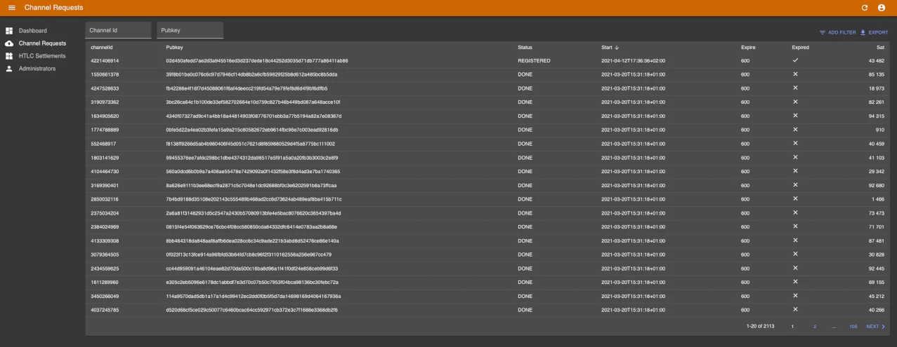

# 💥 Dunder LSP

_Work In Progress, not suited for production just yet._
_Contributions, suggestions and ideas are appreciated._
_Database schema and configuration are bound to change._

Dunder is a Lightning Service Provider for the Bitcoin Lightning Network.

It currently supports "on demand channel openings", meaning if a Lightning wallet
gets an inbound payment while not having any inbound capacity, Dunder will open
a channel to the wallet with push amount equal to the inbound payment minus the
on-chain fee.

More on how this works [here](https://github.com/hsjoberg/blixt-wallet/issues/242).

## Disabling channel opening

Set `"channelOpeningEnabled": false` in your config and restart Dunder to stop
it from opening any new channels. The setting is optional and defaults to `true`.
While it is disabled:

- `/ondemand-channel/register` and `/ondemand-channel/claim` return HTTP 503.
- `/ondemand-channel/service-status` reports `status: false`.
- Incoming payments for already registered channel requests are failed instead
  of settled, so payers are not charged.
- Auto-heal and the background recovery loop do not open channels. Payments
  that were already settled stay unclaimed until channel opening is enabled
  again.
- Channel opens that were already sent to lnd are still reconciled and recorded.

## Known limitations

### Fee increases after registration

Dunder enforces the configured on-chain fee ceiling when a request is registered
and again when it is ready to open the channel. During HTLC interception, however,
it currently checks only that the estimated fee leaves a positive channel push
amount. If fees rise above the configured ceiling after registration, Dunder may
therefore settle the payment and defer the channel opening until the fee estimate
falls below the ceiling. The settlement remains recorded for recovery, but the
recipient will not receive the channel immediately.

## Build

Dunder require lnd as the Lightning backend right now, though the plan is to
make the service implementation independent.

The `master` branch always expects the latest version of lnd. Lnd compiled with routerrpc is required.

1. Run lnd, wallet must be unlocked for Dunder to operate correctly
2. `git clone https://github.com/hsjoberg/dunder-lsp && cd dunder-lsp`
3. Copy `config/default.json_TEMPLATE` to `config/default.json` and set up your configuration
4. `cd src/services/admin/react-admin`
5. `npm install --legacy-peer-deps`
6. `cd ../../../../`
7. `npm install`
8. `npm run proto`
9. `npm run build`
10. `npm start`

## Running in production

### lnd settings

Add these to `lnd.conf`:

```ini
[routerrpc]
# Optional. While Dunder is disconnected, fail new forwards instead of
# forwarding them unchecked, and keep HTLCs Dunder was holding so they are
# replayed when it reconnects (fewer failed on-demand payments across Dunder
# restarts). Cost: the node routes nothing while Dunder is down.
# routerrpc.requireinterceptor=true

[Application Options]
# Lets Dunder recover the outcome of an HTLC whose settle event it missed
# (restart, stream reconnect).
store-final-htlc-resolutions=true
```

### Restricted macaroon

Dunder doesn't need lnd's `admin.macaroon`. Bake one limited to the RPCs it
calls and point `backendConfig.adminMacaroon` at it:

```sh
lncli bakemacaroon --save_to dunder.macaroon \
  uri:/lnrpc.Lightning/GetInfo \
  uri:/lnrpc.Lightning/EstimateFee \
  uri:/lnrpc.Lightning/NewAddress \
  uri:/lnrpc.Lightning/WalletBalance \
  uri:/lnrpc.Lightning/VerifyMessage \
  uri:/lnrpc.Lightning/ListPeers \
  uri:/lnrpc.Lightning/ListChannels \
  uri:/lnrpc.Lightning/PendingChannels \
  uri:/lnrpc.Lightning/ClosedChannels \
  uri:/lnrpc.Lightning/LookupHtlcResolution \
  uri:/lnrpc.Lightning/SubscribePeerEvents \
  uri:/lnrpc.Lightning/OpenChannelSync \
  uri:/routerrpc.Router/HtlcInterceptor \
  uri:/routerrpc.Router/SubscribeHtlcEvents
```

### HTTPS and the admin interface

Dunder serves plain HTTP; put it behind a reverse proxy that terminates TLS.
When `serverDomain` starts with `https://`, the admin session cookie is marked
`Secure` and is only set when the proxy sends `X-Forwarded-Proto: https`
(Caddy does this by default; nginx needs
`proxy_set_header X-Forwarded-Proto $scheme;`). Without that header admin login
fails.

### Configuration

| Key | Default | Meaning |
| --- | --- | --- |
| `htlcWaitSeconds` | 60 | How long the parts of a multi-part payment are held while waiting for the rest. Replaces `htlcWaitMs`, which was always read as seconds. |
| `allowLegacySignatures` | `true` | Accept wallet requests signed with the old fixed words (`REGISTER`, `CLAIM`, `CHECKSTATUS`). Turn off once wallets use signed messages. |
| `maxOpenRequestsPerPubkey` | 5 | Unpaid, unexpired requests a wallet may have at once. |
| `signedRequestRateLimitPerMinute` | 30 | Signed wallet requests accepted per pubkey per minute. |
| `ipRateLimitPerMinute` | 120 | Requests to the public API (`/ondemand-channel/*`, `/getInfo`, `/estimateFee`) per client IP per minute. `0` turns it off. |
| `trustProxy` | `false` | Fastify `trustProxy`: which reverse proxies to trust for `X-Forwarded-For`, e.g. `"127.0.0.1"`. **Set this when running behind a proxy**, otherwise every client has the proxy's address and shares one rate limit. |

### Signed wallet requests

`/ondemand-channel/register`, `/claim` and `/check-status` take a body of

```json
{ "pubkey": "<hex, optional>", "message": "<signed JSON text>", "signature": "<lnd SignMessage signature>" }
```

where `message` is the exact JSON text that was signed:

```json
{
  "endpoint": "/ondemand-channel/register",
  "domain": "<host of Dunder's serverDomain>",
  "timestamp": 1731628800,
  "nonce": "<random string, 8-128 characters>",
  "data": { "amountSat": 50000, "preimage": "<64 hex characters>" }
}
```

Request fields are read from `data` (`claim` and `check-status` have none). A
message is accepted within 30 seconds of its timestamp and only once.
`domain` must match the host of Dunder's `serverDomain`, so wallets must reach
Dunder under that name. `/ondemand-channel/service-status` returns
`"requestSigningVersion": 2` so wallets know they can use this format. Version
1, signing only a fixed word, is what older Dunder servers accept.

# Admin interface

<div>
  
</div>

The admin interface is reachable via `/admin`.

To create an administrator, run `scripts/create-admin-lnurl-auth.js` and scan the QR-code with an
LNURL-auth compatible wallet (for example [Blixt Wallet](https://blixtwallet.github.io)):

`node scripts/create-admin-lnurl-auth.js <listen host:ip> <domain/IP to reach from)> <HTTPS (true/false)>`

This will create a temporary HTTP server serving an LNURL-auth endpoint at /lnurl-auth.

# Test

To do tests run `npm run test` or `npm run test:coverage`.

Any new code should not decerease code coverage significantly.

## License

MIT
